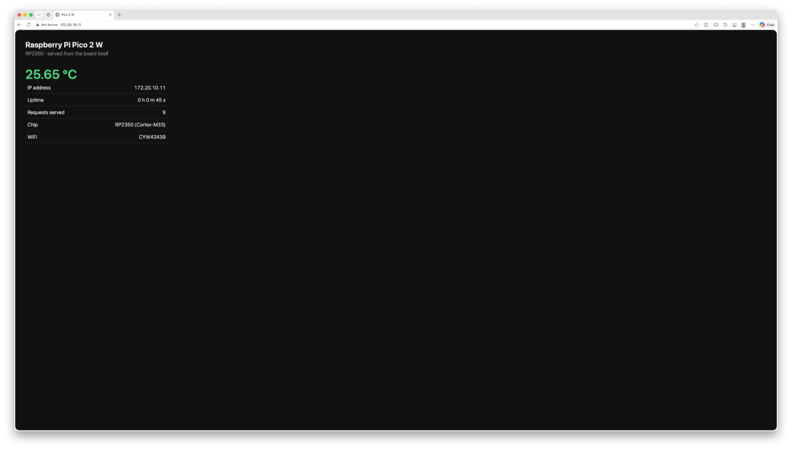

# Pico 2 W — `webserver`

An HTTP server running on the board itself. Joins a WiFi network, listens on
port 80, and serves a status page showing the RP2350's on-die temperature,
uptime, and how many requests it has handled.

The page also **scans for nearby networks and lets you join one from the
browser**. The choice is written to flash, so it survives a power cycle. If
there is nothing stored and the compiled-in network cannot be joined, the board
hosts **its own access point** and serves the same page there as a captive
portal — so a board that cannot reach any network is still reachable.

No cloud, no broker, no host PC — the board is the web server.

Built on macOS with VS Code, the Raspberry Pi Pico extension, and a Raspberry Pi
Debug Probe.

## Result

> The screenshot and the measurements below are from the original version,
> which generated one HTML page per request. The page is now a static file
> served from flash with the live values arriving as JSON, so none of these
> figures match any more. The reasoning about `Content-Length` still holds; the
> numbers and the screenshot want recapturing.



Live chip temperature, IP address, uptime, request count and chip details —
generated and served by the board itself, with no host involved.

Verified independently with `curl` from a machine on the same network:

```
$ curl -D - http://172.20.10.11/

HTTP/1.1 200 OK
Content-Type: text/html; charset=utf-8
Content-Length: 991
Connection: close
```

The body measured **exactly 991 bytes** against the declared `Content-Length:
991` — nothing truncated, which confirms the connection is closed only after
all data is acknowledged.

Values from that response:

```
25.73 degC
IP address        172.20.10.11
Uptime            0 h 1 m 19 s
Requests served   23
Chip              RP2350 (Cortex-M33)
WiFi              CYW43439
```

And the counter read straight off the chip afterwards, having climbed further
over a few reloads:

```
(gdb) print request_count
$1 = 29
```

Console output:

```
Starting Wi-Fi...
Connecting to 'iPhone13'...
Connected. IP address: 172.20.10.11
HTTP server listening on http://172.20.10.11/
Open that address in a browser on the same network.

GET / -> 1187 bytes
GET / -> 1187 bytes
```

## Seeing it work

**The browser must be on the same network as the board.** This is the one thing
that catches people out — a Pico on a phone hotspot is not reachable from a
laptop on a different WiFi network. There is no routing between them. The
screenshot above was taken after joining the laptop to the same hotspot the
board is on.

### Option A — phone hotspot

The phone providing the hotspot is on the same subnet as the board, so it can
reach it directly.

1. Turn the hotspot on, with **Maximize Compatibility** enabled (2.4 GHz — the
   CYW43439 has no 5 GHz radio).
2. Reset the board and read the IP from the console.
3. Open `http://172.20.10.11/` in the phone's browser.

### Option B — join the same network as your computer

Put that network's credentials in `wifi_secrets.cmake`, rebuild, and the board
gets an address on the same subnet:

```cmake
set(WIFI_SSID     "YourHomeNetwork")
set(WIFI_PASSWORD "...")
```

Then from the computer:

```bash
curl -v http://<pico-ip>/
```

This is the better option for development — it lets you test with `curl`,
browser dev tools, and load-testing tools.

### Option C — the board's own access point

Needs no credentials at all. With nothing in `wifi_secrets.cmake` and nothing
stored in flash, the board comes up as its own access point:

```
No stored network and no compiled-in default.
Starting setup access point 'pico-setup' (password 'picosetup')
Join 'pico-setup' and open http://192.168.4.1/
```

Join `pico-setup` from a phone or laptop and the captive-portal sheet opens on
its own. Pick a network, enter the password, submit — the board joins it, saves
it, and comes up on that network on every boot after that.

## Changing networks from the browser

| Route | Does |
|---|---|
| `GET /` | `index.html`, straight out of flash |
| `GET /app.css`, `/app.js` | any file embedded from `web/` |
| `GET /api/status` | JSON: mode, network, IP, temperature, uptime, requests |
| `GET /api/networks` | JSON: the last completed scan |
| `POST /api/scan` | queues a scan, `204` |
| `POST /connect` | `ssid` + `other` + `pass` — joins, and saves on success |
| `POST /forget` | erases the stored network and restarts into setup mode |

The page is static and cached; everything live arrives as JSON and is polled
every 5 s by `app.js`. The forms are ordinary `POST`s, so they still work with
JavaScript blocked — `app.js` only intercepts them to stay on the page.

In access-point mode every other path also serves the page. That is what makes
the captive-portal sheet appear: the board's DNS answers every query with
`192.168.4.1`, so whatever the phone probes on joining lands here.

### Web assets live in flash, and are never copied

`web/` holds real `.html`, `.css` and `.js` files. At build time
`tools/embed_assets.py` gzips each one and emits `assets.c` — a `const unsigned
char[]` per file plus a lookup table:

```
embed_assets: 3 file(s), 15,291 B -> 5,384 B in flash (9,907 B saved)
  /app.css         5,934 B ->   1,901 B  gzip
  /app.js          6,799 B ->   2,417 B  gzip
  /index.html      2,558 B ->   1,066 B  gzip
```

`const` puts them in `.rodata`, and flash is memory-mapped at `XIP_BASE`, so
the bytes can go to lwIP **without** `TCP_WRITE_FLAG_COPY`:

```c
flags = c->body_in_flash ? 0 : TCP_WRITE_FLAG_COPY;
tcp_write(pcb, src, chunk, flags);
```

With the flag, lwIP copies the body into pbufs — RAM proportional to the file.
Without it, lwIP keeps a pointer into flash until the data is acknowledged,
which is safe precisely because flash never moves. A 200 KB asset would cost
the same RAM as a 200-byte one.

There is one interaction to respect: `flash_range_program()` disables XIP while
it runs, so a zero-copy send **during** a credential write would read garbage.
The 1.2 s delay before any queued action exists partly for this reason — the
response is acknowledged, and its pbufs released, before flash is touched.

Files are served with an `ETag` (a CRC32 of the *uncompressed* bytes, so it is
stable whether or not compression won) and `Cache-Control: no-cache`, which
means "revalidate before use" rather than "do not store". The browser comes
back with `If-None-Match` and normally gets a 100-byte `304` instead of the
file. That is the right trade for a dev board: reflash and the page updates,
with no stale-cache confusion.

Adding a file is just dropping it in `web/` — CMake globs with
`CONFIGURE_DEPENDS` and regenerates.

### Budgets

Measured from the build, not the datasheet:

| | Used | Free |
|---|---|---|
| **Flash** (4 MB) | 336 KB image + 4 KB credentials + 12 KB reserved | **~3.66 MB** |
| **SRAM** (520 KB) | ~57 KB static | ~456 KB heap + stack |

Flash is not the constraint and will not become one — the whole UI is 5.4 KB
compressed, and the image is 336 KB after dropping `sscanf` (below). The things that actually bind:

**Core 0's stack is 2 KB** (`__StackBottom` 0x20081800 to `__StackTop`
0x20082000), and these callbacks run in lwIP's background interrupt on it.
Nothing large may be a local. Every buffer lives in the heap-allocated
`http_conn_t`, which is why responses are assembled into `c->dyn` rather than
into a local array.

**Per-connection RAM** is `http_conn_t`, about 5.4 KB — a 1 KB request buffer,
a 4 KB buffer for generated bodies, and the header. Four connections in the
backlog is ~21.6 KB of heap. Static assets add nothing to this because they are
never copied.

**`MEMP_NUM_TCP_PCB`** matters now. A browser opens up to 6 parallel
connections to one host and the page pulls three files, so lwIP's default of 5
would stall; it is 12 in `lwipopts.h`.

**`sscanf` is not used to parse the request line.** `sscanf("%7s %159s")` links
newlib's `__ssvfscanf_r`, `_strtod_l` and its float tables — **49,364 bytes**
of flash, measured by removing it. `split_request_line()` does the same job in
a dozen lines, and the image dropped from 389,552 to 340,188 bytes.

### Scanning is asynchronous

`cyw43_wifi_scan()` hands back results on a callback over two or three seconds.
An HTTP handler cannot wait for that, so `/scan` only sets a flag — the main
loop starts the scan, `wifi_scan_poll()` latches completion, and the finished
list is cached for the next page load. Reload once and the networks are there.

Scanning while hosting the access point works, but the radio has to leave its
own channel to do it, so a client may see a brief stall.

### Nothing touches the radio from an interrupt

With `pico_cyw43_arch_lwip_threadsafe_background`, the HTTP callbacks run in
lwIP's background interrupt. Joining a network blocks for up to 20 seconds and
writing flash disables interrupts outright — neither belongs there. So the
handlers only queue work through `app.h`:

```c
void app_request_scan(void);
void app_request_connect(const char *ssid, const char *pass);
void app_request_forget(void);
```

and `main()` carries it out. Queued actions also wait 1.2 s before running, so
the response that triggered them is on the wire before the network it arrived
over disappears.

### Credentials in flash

The **fourth sector from the end** — `PICO_FLASH_SIZE_BYTES - 4 *
FLASH_SECTOR_SIZE`, so `0x3FC000` on a 4 MB board — holds a magic number, a
version, the SSID, the password and a CRC32.

| Offset | Size | Holds |
|---|---|---|
| `0x000000` – `0x052188` | 336,264 B | program image (8.0% of flash) |
| `0x052188` – `0x3FC000` | 3,841,656 B | free |
| `0x3FC000` – `0x3FD000` | 4 KB | **these credentials** |
| `0x3FD000` – `0x3FF000` | 8 KB | reserved for a BTstack link-key bank |
| `0x3FF000` – `0x400000` | 4 KB | reserved — RP2350 E10 errata workaround |

Not the last sector, which is where this used to be and which was a latent
bug. The RP2350 E10 errata workaround wants the final sector free, and the
SDK's own BTstack flash bank skips it whenever `PICO_RP2350_A2_SUPPORTED` is
set — which `pico2_w.h` sets by default. The old offset looked right and was
quietly standing on reserved ground.

The two sectors below it are left clear for BTstack's link-key store. This
project does not link `pico_btstack_flash_bank` today, but reserving the space
costs nothing and means adding Bluetooth later cannot silently overwrite
settings. The `setup_portal` project uses the same offset for the same reasons.

Two guards keep it honest: `_Static_assert`s that the sector is aligned and
clear of the top three, and a runtime check of `__flash_binary_end` that
refuses to touch flash at all if the image ever grows far enough to reach the
store.

**Moving the offset orphans any credentials written by an earlier build.** The
magic number is not found at the new location, `wifi_store_load()` returns
false, and the board falls back to the compiled-in network or to setup mode —
the designed fallback doing its job, not a migration step. Re-provision once
after flashing this.

`flash_range_erase()` and `flash_range_program()` run with interrupts disabled,
which stalls the background interrupt servicing lwIP for a few tens of
milliseconds. That is why the write happens after the HTTP response is fully
acknowledged, never during one.

A bad CRC, an unterminated string or an empty SSID all read as "nothing
stored", so a half-finished write falls back to the compiled-in network rather
than bricking the board into an address you cannot reach.

### If a join fails

The board re-enables the setup access point and puts the reason on the page.
There is no state in which it is both unreachable and unable to be told where
to go.

## How it works

lwIP's **raw TCP API**, not sockets. There is no operating system and no thread
to block, so the server is a set of callbacks that lwIP invokes from a
background interrupt.

```c
struct tcp_pcb *pcb = tcp_new_ip_type(IPADDR_TYPE_ANY);
tcp_bind(pcb, IP_ANY_TYPE, 80);
struct tcp_pcb *listener = tcp_listen_with_backlog(pcb, 4);
tcp_accept(listener, http_accept);
```

Four callbacks carry the whole server:

| Callback | Fires when | Does |
|---|---|---|
| `http_accept` | a client connects | allocates per-connection state, registers the rest |
| `http_recv` | request bytes arrive | builds the page, `tcp_write` + `tcp_output` |
| `http_sent` | the client ACKs data | closes and frees once everything is acknowledged |
| `http_err` | the connection fails | frees state; lwIP has already freed the pcb |

Three details that matter:

**`tcp_recved(pcb, p->tot_len)`** — tells lwIP you have consumed the data so it
can reopen the receive window. Omit it and the connection stalls after the first
segment.

**`pbuf_free(p)`** — lwIP's buffers are reference-counted and yours to release.
Leaking them exhausts `PBUF_POOL_SIZE` and the server dies after a few requests.

**Close in `http_sent`, not in `http_recv`.** Closing right after `tcp_write`
discards unacknowledged data, and the browser gets a truncated page. Wait until
`sent >= len`.

**Send in chunks bounded by `tcp_sndbuf()`.** A response is a header in RAM
followed by a body in either RAM or flash, and `send_more()` walks the two in
order, writing at most what the send buffer currently has room for and
resuming from `http_sent` as space frees up. A single `tcp_write` of the whole
thing would fail with `ERR_MEM` on anything larger than `TCP_SND_BUF`.

The request itself is never parsed — any request gets the same page. That is
deliberate: it keeps the example to one job. Parsing the path is the natural
next step.

### Why `Connection: close`

Each response sets `Content-Length` and `Connection: close`, so the browser
knows where the body ends and does not hold the socket open. With only a handful
of TCP PCBs configured in `lwipopts.h`, keep-alive connections would exhaust
them quickly.

### Temperature on the page

Same sensor as the `internal_temperature` project — ADC channel 4, 16 samples
averaged, `T = 27 - (V - 0.706) / 0.001721`. It is read fresh on every request,
so reloading the page shows the chip actually warming and cooling.

## Setup

### Files

| File | Holds |
|---|---|
| `webserver.c` | `main()`, the boot/fallback state machine, the queued actions |
| `http_server.c` | request parsing, routes, the pages |
| `wifi_scan.c` | the asynchronous scan and its result cache |
| `wifi_store.c` | the flash-backed credential record |
| `dhcpserver.c` | hands addresses to clients of the setup access point |
| `dnsserver.c` | answers every A query with `192.168.4.1` for the portal |
| `app.h` | the only thing the HTTP layer knows about the rest |
| `web/` | the actual `index.html`, `app.css`, `app.js` |
| `tools/embed_assets.py` | gzips `web/` into `assets.c` at build time |

`assets.c` and `assets.h` are generated into
`build/generated/web_assets/` — not checked in, and not edited by hand.

The DHCP server and the DNS responder are written here against lwIP's raw UDP
API rather than pulled in from `pico-examples`, so the project has no source
outside this directory.

### CMakeLists.txt

```cmake
target_link_libraries(webserver
    pico_stdlib
    hardware_adc                                 # on-die temperature sensor
    hardware_flash                               # stored credentials
    hardware_sync                                # interrupt lockout around flash writes
    hardware_watchdog                            # restart after "forget network"
    pico_cyw43_arch_lwip_threadsafe_background   # WiFi + lwIP on a background IRQ
)
```

`threadsafe_background` is the right choice: lwIP is serviced from an interrupt,
so `main()` is free and the TCP callbacks fire on their own. With
`..._lwip_poll` you would have to call `cyw43_arch_poll()` continuously or the
server would never respond.

### lwipopts.h

Required — lwIP ships no defaults. Copied from the `wifi` project; `LWIP_TCP`,
`LWIP_DHCP` and the `TCP_*` buffer sizes are what matter here.

Access-point mode adds two UDP listeners on top of the station DHCP client, so
`MEMP_NUM_UDP_PCB` goes to 8 and `MEM_SIZE` to 8000. `MEMP_NUM_TCP_PCB` goes to
12 for the parallel asset fetches — see **Budgets**.

### Credentials

Same gitignored pattern as the `wifi` project, but now entirely optional — with
no secrets file the board comes up in setup mode and you provision it from the
browser:

```cmake
include(${CMAKE_CURRENT_LIST_DIR}/wifi_secrets.cmake OPTIONAL)
target_compile_definitions(webserver PRIVATE
    WIFI_SSID=\"${WIFI_SSID}\"
    WIFI_PASSWORD=\"${WIFI_PASSWORD}\"
)
```

The compiled-in network is the fallback, not the source of truth. Boot order is
**stored credentials → compiled-in `WIFI_SSID` → setup access point**, so once
you have joined a network from the browser, that is what the board uses.

## Build and flash

The asset step needs Python 3 on `PATH`; CMake finds it with
`find_package(Python3)` and nothing else is required — `gzip` and `zlib` are in
the standard library.

```bash
cd 3.integration-testing/webserver

~/.pico-sdk/cmake/v4.3.4/bin/cmake -B build -G Ninja \
  -DCMAKE_BUILD_TYPE=Debug -DPICO_BOARD=pico2_w -DPICO_PLATFORM=rp2350-arm-s .

~/.pico-sdk/ninja/v1.13.2/ninja -C build

~/.pico-sdk/openocd/0.12.0+dev/openocd \
  -s ~/.pico-sdk/openocd/0.12.0+dev/scripts \
  -f interface/cmsis-dap.cfg -f target/rp2350.cfg \
  -c "adapter speed 5000" \
  -c "program build/webserver.elf verify reset exit"
```

## Troubleshooting

| Symptom | Cause and fix |
|---|---|
| Console stops after `Connecting to '...'` | network down, 5 GHz only, or wrong password — see the `wifi` project's README |
| `Failed to connect` then a reboot loop | returning from `main()` restarts the runtime; expected on failure |
| Browser times out | your computer is on a different network from the board |
| Page loads once, then never again | pbufs leaked, or the connection closed before data was ACKed |
| Page is truncated | closed in `http_recv` instead of `http_sent` |
| `undefined reference to tcp_new_ip_type` | wrong cyw43 arch library — needs an `_lwip_` variant |
| Network list is empty | no scan has run yet — follow the Scan link and reload once |
| Join from the browser never completes | 5 GHz or WPA2-Enterprise; the CYW43439 does neither |
| Board forgets the network on reboot | flash write failed — the page says so when it happens |
| Stuck on a network you cannot reach | hold the reasoning in reverse: the board is fine, it just is not where you are. `POST /forget` from that network, or reflash |
| `pico-setup` does not appear | the AP needs a password of at least 8 characters for WPA2 |

| Page loads but stays on `···` and the dot is grey | `/api/status` is failing — check the console for the request arriving |
| Page is unstyled, or the console shows a failed asset | asset missing from `web/`, or `MEMP_NUM_TCP_PCB` too low for the parallel fetches |
| Edited `web/` but nothing changed | the browser revalidates with `If-None-Match`; a changed file gets a new ETag, so force-reload if you edited mid-request |
| Hard fault or silent reboot on the first request | something large became a stack local — core 0's stack is 2 KB, see **Budgets** |

Two blinks of the onboard LED means setup mode; one means it is joined.

Check what the board thinks its address is, without the console:

```bash
~/.pico-sdk/toolchain/15_2_Rel1/bin/arm-none-eabi-gdb build/webserver.elf -q -batch \
  -ex "target extended-remote 127.0.0.1:3333" -ex "monitor halt" \
  -ex "print/x netif_default->ip_addr.addr" -ex "print request_count"
```

`0x0` means DHCP has not completed — the board is not on the network yet. The
address is little-endian, so `0x0b0a14ac` is `172.20.10.11`.

## Next steps

Routing, JSON endpoints and flash-resident static files are all in, so what is
left:

- **Control an LED or GPIO** from the page — the classic IoT demo.
- **Add mDNS** so it answers to `pico.local` instead of a bare IP, which would
  also solve "the address changed after it joined".
- **A chart of the temperature over time**, now that there is somewhere sane to
  put the JavaScript.
- **A real filesystem** (littlefs in the spare 3.6 MB) if assets ever want to
  be uploaded at runtime rather than baked in.
